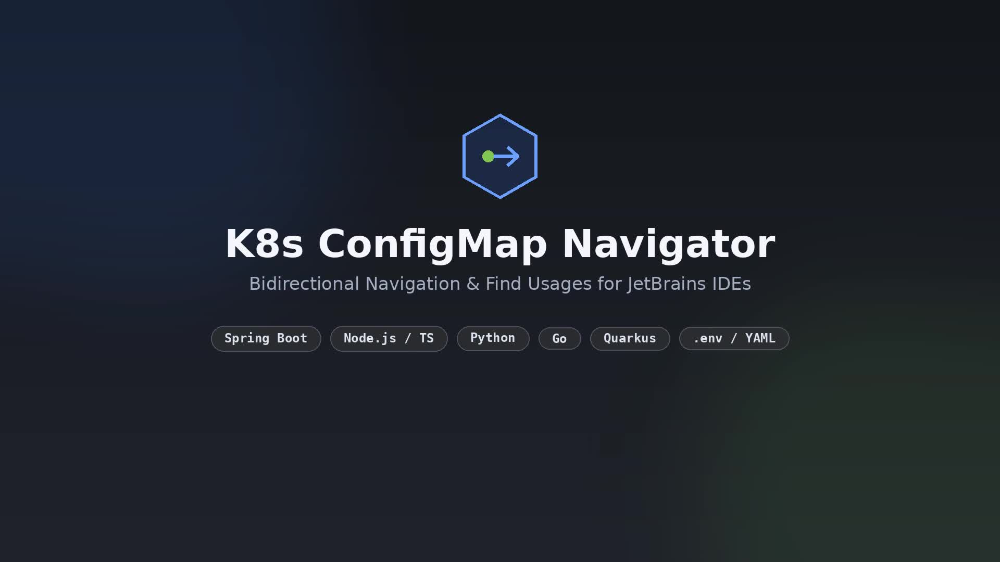
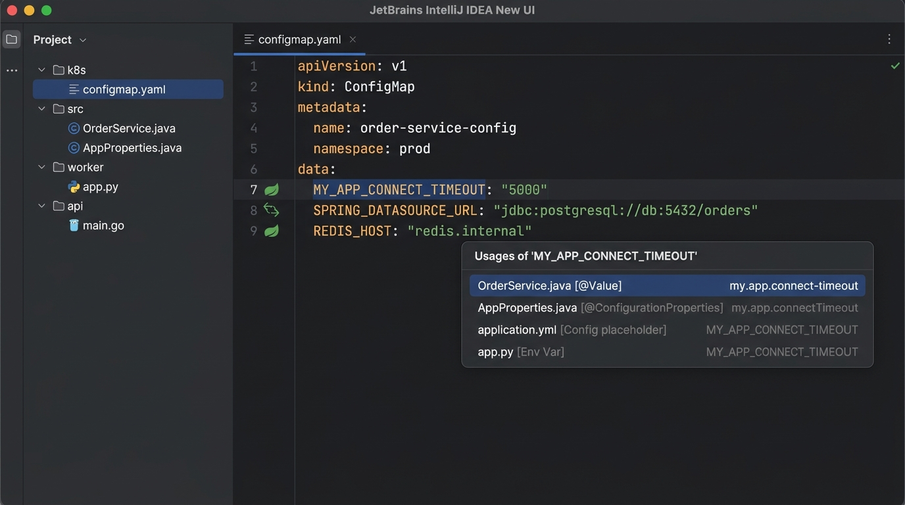
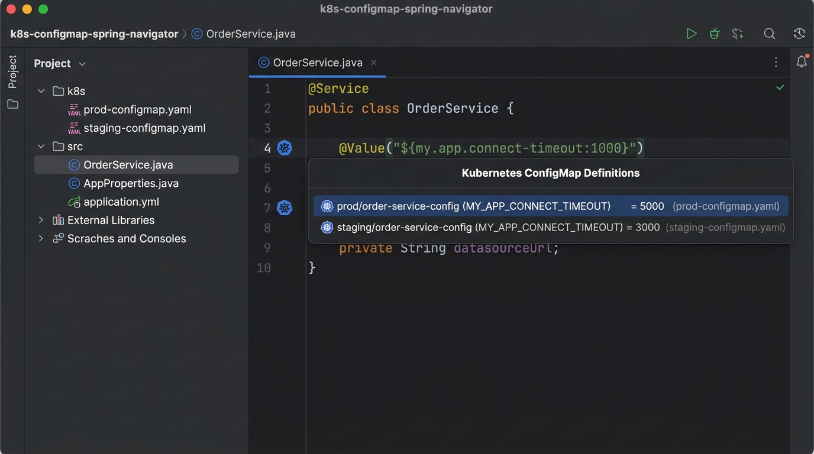

# K8s ConfigMap Navigator



A universal JetBrains IDE plugin that helps developers **find usages** and **navigate bidirectionally** between Kubernetes `ConfigMap` YAML keys and application code across any stack.

Works on **IntelliJ IDEA (Community & Ultimate)**, **PyCharm**, **GoLand**, **WebStorm**, **Rider**, **PhpStorm**, and **RustRover** (2024.3+).

## Screenshots

### 1. ConfigMap → Application Usages
Gutter icons, `Ctrl+Click`, and native `Alt+F7` Find Usages across Java, Kotlin, Python, Go, Node.js, and YAML with relaxed binding:



### 2. Code → Kubernetes ConfigMap Definitions
Jump directly from application code or config files to matching `prod` & `staging` ConfigMap keys with namespace and live value previews:



## Supported Ecosystems

- **Java & Kotlin (Spring Boot, Quarkus, Micronaut)**:
  - `@Value("${my.app.timeout:3000}")` (multiple placeholders & SpEL)
  - `@ConfigurationProperties(prefix = "my.app")` (classes, records, Kotlin data classes, nested classes)
  - `@ConfigProperty(name = "my.app.timeout")` (Quarkus / MicroProfile)
  - `Environment.getProperty(...)`, `System.getenv(...)`, `System.getProperty(...)`
  - `application*.yml` / `application*.properties` / `bootstrap*` (placeholders & direct property overrides)
- **Node.js / TypeScript / JavaScript**: `process.env.KEY`, `process.env["KEY"]`, `import.meta.env.KEY`
- **Python**: `os.getenv("KEY")`, `os.environ["KEY"]`, `os.environ.get("KEY")`
- **Go**: `os.Getenv("KEY")`, `os.LookupEnv("KEY")`, `viper.GetString("my.key")`
- **C# / .NET**: `Environment.GetEnvironmentVariable("KEY")`
- **Rust**: `env::var("KEY")`, `env::var_os("KEY")`
- **PHP**: `getenv("KEY")`, `$_ENV["KEY"]`, `$_SERVER["KEY"]`
- **Ruby**: `ENV["KEY"]`, `ENV.fetch("KEY")`
- **Config Files**: `.env` / `.env.*`, YAML, `.properties`, TOML, and JSON `${KEY}` placeholders

## Features

- **Relaxed Binding**: Automatically matches `UPPER_SNAKE_CASE` ConfigMap keys (`MY_APP_CONNECT_TIMEOUT`) with `kebab-case`, `camelCase`, `dot.notation`, `snake_case`, and array indices (`MY_LIST_0_NAME` ↔ `my.list[0].name`). Toggleable in settings.
- **Bidirectional Gutter Icons & `Ctrl+Click`**: Jump from ConfigMap keys to usages, or from code/config back to ConfigMap definitions (with namespace, name, and value preview).
- **Native Find Usages (`Alt+F7`)**: Invoke Find Usages directly on any `ConfigMap` `data:` key.
- **Monorepo & Multi-Repo**: Configure external Kubernetes ConfigMap or application directories under **Settings → Tools → K8s ConfigMap Navigator**.

## Installation

### Option 1: JetBrains Marketplace
1. Open your JetBrains IDE (**IntelliJ IDEA**, **PyCharm**, **GoLand**, **WebStorm**, **Rider**, **PhpStorm**, or **RustRover**).
2. Go to **Settings / Preferences → Plugins → Marketplace**.
3. Search for **K8s ConfigMap Navigator** and click **Install**.

### Option 2: Install Manually from GitHub Releases
1. Download the latest plugin `.zip` from the [GitHub Releases](https://github.com/jamilxt/k8s-configmap-navigator/releases/latest) page.
2. Open your JetBrains IDE and go to **Settings / Preferences → Plugins**.
3. Click the **⚙️ (gear icon)** → **Install Plugin from Disk...**
4. Select the downloaded `.zip` file and click **OK**.

### Option 3: Build & Install Locally from Source
Requires **JDK 21+**:
```bash
git clone https://github.com/jamilxt/k8s-configmap-navigator.git
cd k8s-configmap-navigator
./gradlew buildPlugin
```
Then install the generated ZIP from `build/distributions/k8s-configmap-spring-navigator-*.zip` via **Settings → Plugins → ⚙️ → Install Plugin from Disk...** (or run `./gradlew runIde` to test in a sandboxed IDE).

## Development & Publishing

```bash
# Run unit & integration tests
./gradlew test

# Build installable plugin ZIP (build/distributions/)
./gradlew buildPlugin

# Launch sandboxed IDE with plugin installed
./gradlew runIde

# Publish to JetBrains Marketplace (requires PUBLISH_TOKEN env var)
./gradlew publishPlugin
```

## Privacy & License

- **Privacy**: 100% local inside your IDE — zero telemetry or network calls. See [PRIVACY.md](PRIVACY.md).
- **License**: [MIT](LICENSE)
